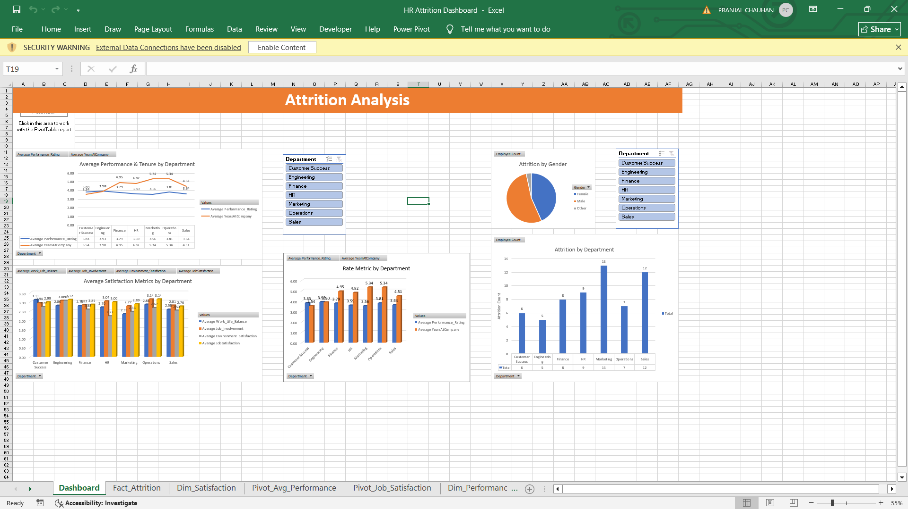

# HR Attrition Analysis Dashboard (Excel)

An interactive Excel dashboard that analyzes employee attrition, performance, and satisfaction using a star-schema data model, pivot tables, pivot charts, and slicers.

## Business Problem
HR teams need to know who leaves, when, and what is linked to it. This project is a scenario built around an HR dataset to report attrition by department, gender, and role, and to relate it to overtime, income, promotion gaps, performance, and satisfaction.

## Goal of the Dashboard
Give HR one view of workforce attrition so it can spot risk areas and decide where to act.

## Dataset
- **Size:** 60 employees, 1,797 monthly attrition records (Jan 2022 to Dec 2024), 180 performance records, and 180 satisfaction records
- **Model:** `Fact_Attrition` linked to `Dim_Employee`, `Dim_Date`, `Dim_Performance`, and `Dim_Satisfaction`

## Data Cleaning
- Removed a duplicate attrition column (`Attrition_Status_1`)
- Fixed text formatting issues in the manager feedback field

## Dashboard Contents
- Pivot tables: attrition by department, attrition by gender, average performance, and job satisfaction
- Pivot charts and slicers for filtering by department and other fields
- KPI summary of attrition rate and headcount

## Key Insights
- 3 of 60 employees (5%) left, all in 2023.
- Attrition occurred in Finance (1 of 8), HR (1 of 9), and Marketing (1 of 13). No other department had any.
- Employees who left worked overtime in about 16% of their months, vs. 8% for those who stayed.
- Employees who left averaged 1.9 years since last promotion vs. 1.3 for those who stayed.
- With only 3 leavers, these are early signals and not statistically conclusive.

## Recommendations
- Review overtime workload in the departments where people left.
- Track promotion gaps, since leavers waited longer for promotion.
- Collect more data over time before drawing firm conclusions.

## Tools and Techniques
- Excel pivot tables, pivot charts, and slicers
- Star-schema data modelling
- Data cleaning and validation
- KPI calculations: attrition rate, average performance, average satisfaction

## Repository Structure
- `Data/` source dataset
- `Screenshots/` dashboard images
- `HR_Attrition_Dashboard.xlsx` Excel dashboard
- `README.md`

## How to Use
Download the `.xlsx` file and open it in Excel. Use the slicers to filter by department and other fields.

## Author
Pranjal Chauhan | [LinkedIn](http://www.linkedin.com/in/pranjal-chauhan-34a7b3252) | pranjalchauhantech@gmail.com
